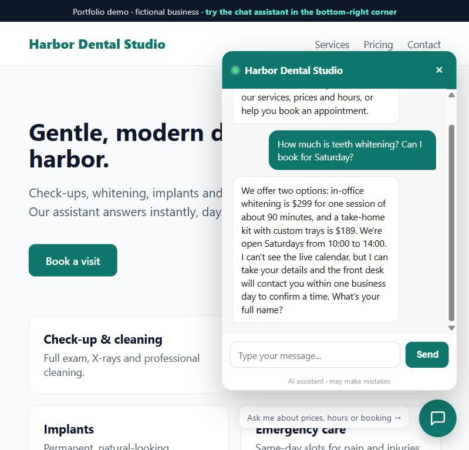

# AI Customer Support Chatbot for Business Websites

An AI assistant you can add to **any website with one line of code**. It answers visitor
questions 24/7 from the business's own information (services, prices, hours, policies) and
**turns conversations into leads** by collecting the visitor's name, contact and request.

Built with **Python · FastAPI · Claude API (Anthropic) · vanilla JS**.

**▶ Live demo: [ai-support-chatbot-u82s.onrender.com](https://ai-support-chatbot-u82s.onrender.com/)**
Click the chat bubble in the bottom-right corner and ask in any language. The free server sleeps when idle, so the first load can take up to a minute.



## Features

- **One-line install.** A single `<script>` tag works on WordPress, Shopify, Wix, Webflow or plain HTML.
- **Answers only from your content.** The bot uses a plain Markdown knowledge base and
  tells visitors when it doesn't know something, so it doesn't make answers up.
- **Lead capture.** When a visitor wants an appointment, quote or callback, the bot collects
  their details and saves them (`data/leads.jsonl`, or via `GET /api/leads`).
- **Multilingual.** It replies in the visitor's language automatically.
- **Real-time streaming.** Replies appear word by word.
- **Style-safe widget.** It runs in a Shadow DOM, so the host site's CSS can't break it. Colour, title
  and welcome text are set with `data-` attributes. It works on mobile.
- **Production basics.** Per-IP rate limiting, input length limits, a CORS allow-list,
  a resistant system prompt, prompt caching (lower API cost), and automatic model fallback.
- **Demo mode.** Shows the UI with no API key and no cost.

## Quick start

```bash
python -m venv .venv
.venv\Scripts\activate            # macOS/Linux: source .venv/bin/activate
pip install -r requirements.txt
copy .env.example .env            # macOS/Linux: cp .env.example .env
# put your ANTHROPIC_API_KEY in .env (or set DEMO_MODE=1)
uvicorn app.main:app --reload
```

Open http://localhost:8000 to see the demo site with the chat bubble.

## Adapting it for a client (about 15 minutes)

1. Replace `knowledge/business.md` with the client's information (services, prices, FAQ, policies).
2. Set `BUSINESS_NAME`, `ALLOWED_ORIGINS` (the client's domain) and `ADMIN_TOKEN` in `.env`.
3. Deploy (Render, Railway, Fly.io or any VPS) and paste this before `</body>` on their site:

```html
<script src="https://YOUR-SERVER/widget.js"
        data-title="Client Name"
        data-color="#0f766e"
        data-welcome="Hi! How can I help?"></script>
```

## Deploying (Render, free tier)

The repo includes a `render.yaml` blueprint. In Render, choose **New → Blueprint**, select this
repo, and enter `ANTHROPIC_API_KEY` when asked. `DAILY_MESSAGE_LIMIT` caps spend on a public demo.
Free instances sleep when idle, so the first request after a pause takes about 30-60 seconds. The free tier
has no persistent disk, so for real clients send leads by email or webhook, or add a database.

## API

| Endpoint | Description |
|---|---|
| `POST /api/chat` | `{"messages":[{"role":"user","content":"..."}]}` → Server-Sent Events stream (`text`, `done`, `error`) |
| `GET /api/leads` | Captured leads (header `X-Admin-Token`) |
| `GET /api/health` | Status, model and demo mode |
| `GET /widget.js` | The embeddable widget |

## Project structure

```
app/main.py       FastAPI routes, SSE streaming, rate limiting, CORS
app/bot.py        Claude integration: grounded system prompt, tool-use loop, demo mode
app/leads.py      Lead storage
static/widget.js  Embeddable chat widget (no dependencies)
static/demo.html  Demo landing page (fictional dental clinic)
knowledge/        Business knowledge base (Markdown)
```

## Cost notes

The model is set with `CLAUDE_MODEL` and defaults to `claude-opus-5-5`. For high-traffic
sites, a smaller model such as `claude-haiku-5-5` costs much less per message. The knowledge
base is prompt-cached, so repeated questions reuse it at a fraction of the input price.
